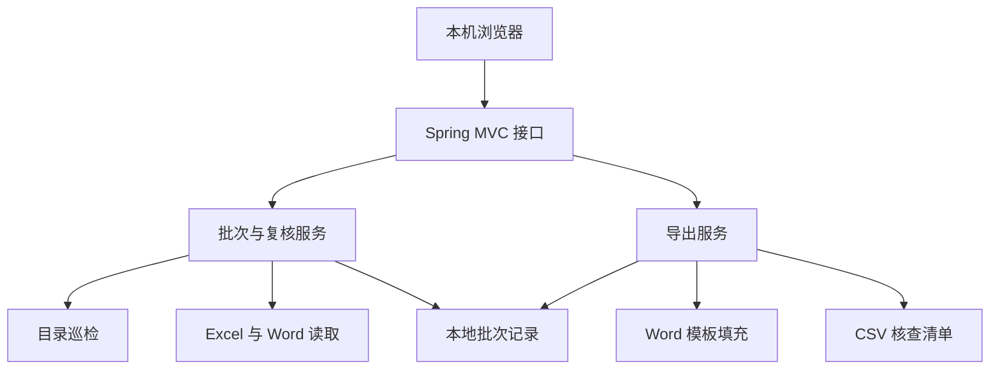

# 一户一档核查工作台

供营销服务中心用电检查人员按户清点材料、核对总容量、记录人工结论，并生成报告初稿。首版面向单台办公电脑上的一次核查任务。

核心记录是一次核查批次。一个批次保存多户档案的巡检发现，每户另存人工结论和确认值。报告生成读取已保存的确认值，因此文件归类、差异核实和结果导出可以连续完成。

## 启动与演示

1. 解压完整项目，保留启动 JAR、lib 和 demo 的相对位置。需安装 Java 8 或 11，以及较新的 Edge、Chrome 或 Safari 浏览器。
2. Windows 双击 start.bat，macOS 可在终端进入项目目录，执行 `sh start.sh`。也可以直接运行 `java -jar archive-workbench.jar`。
3. 在本机浏览器打开 http://127.0.0.1:8765 。点击“用演示数据开始”，选择“创建并巡检”。使用结束后在启动窗口按 Ctrl+C 停止服务。
4. 查看演示甲厂的“容量核对”，选择 DOCX 预案并点击“读取并比对”。台账显示 500 kW，预案显示 400 kW。两份虚拟材料只有差异，未提供裁定哪个值有效的依据。可记录“待查有效版本”并留空确认值，查看初稿如何标注待核实。
5. 在演示乙厂的“异常复核”中，将 A17.txt 人工认领到“自备电源明细”。两份容量资料均记载 630 kVA，可用这户演练填写确认值、单位和依据。在演示丙厂查看整户目录缺失提示。保存后导出 CSV、单户报告或全部台账用户的报告初稿 ZIP。未确认的字段会写为“待核实”。

## 项目架构

同一个 Spring Boot 应用提供本机网页、业务接口和静态资源。浏览器、应用和档案目录位于同一台电脑。Java 侧负责文件读取和生成，网页只发送用户的业务操作。页面显示文件位置，查看原件时可按该位置在本机文件管理器打开。

| 组件 | 职责 | 主要文件 |
| --- | --- | --- |
| 核查工作台 | 切换批次和用户，展示文件与字段出处，提交人工确认，下载结果 | src/main/resources/static |
| HTTP 接口 | 批次、取值、复核和下载。校验本机访问和写请求来源 | BatchController、LocalAccess |
| 批次业务 | 编排输入与巡检，记录来源版本，比较同口径数值，检查保存冲突，保存本户复核版本 | BatchService |
| 目录巡检 | 按台账对齐户目录，递归盘点材料，区分必备／条件适用与单份／多份 | AuditService |
| Office 适配 | XLSX 表头定位、DOCX 表格识别、Word 模板替换。首版统一用 Apache POI | OfficeService |
| 结果导出 | 用已保存的批次生成 CSV 核查清单、单户 Word 初稿和全批报告 ZIP | ExportService |
| 本地存储 | 每个批次单独目录，复制清单与模板，保存结构化结果、人工复核版本及修改历史 | BatchStore |

Java 源码位于 src/main/java/cn/qc/archive。正式 Maven 项目入口为 pom.xml，依赖齐备时可在项目目录运行 `mvn package`，并用 `java -jar target/archive-workbench.jar` 启动。随包提供的是已编译的 JAR 和运行依赖，现场演示无需 Maven 或外网下载。

## 一次核查如何贯穿各模块

1. 建立批次。工作台收集四份输入的位置。BatchService 保存本次规则和模板，OfficeService 从台账取出用户名单及容量，AuditService 将名单与实际文件夹逐一核对。这样可以发现整户目录缺失。
2. 核对字段。经办人选择该户本次有效的预案版本。系统核对文件指纹后，从可编辑表格读取同名标签旁的值，并展示文件、表、行、列。标签明确、数值可解析且两侧单位一致时，才计算数值是否相等。
3. 形成复核结论。经办人可认领错名文件，解释资料差异，登记确认值和依据。保存时记录输入的原文、所用预案版本及本户复核版本。
4. 交接结果。ExportService 从已保存的批次读取复核结果。核查清单可以追溯两处取值。报告模板只接收已确认的容量及单位，未确认时填入“待核实”。因此同一处容量差异可以一直追踪到最终使用了哪个数值。

后续扩展可沿这条业务线进行。新增某类必备材料，只需更新清单。新增“供电方式”等需跨文档核对的字段时，还要定义台账列、预案取值位置、含义与复核方式，再扩展 OfficeService 和批次记录。若开展扫描件识别，可在 Office 读取层增加离线 OCR 适配，并把识别原文、页码及不确定项送入同一复核流程。

## 核查批次的数据边界

- **核查依据**包括建批时的规则文件、Word 模板、Excel 中读取的户名和容量字段，以及当时盘点到的文件路径。每个 DOCX 保存内容指纹，读取或保存所选预案前检查指纹。原件有变更时，重新建批。
- **机器发现**记录未匹配项、多个候选版本、未归类文件等提示。机器发现保留原样，以便回顾本次核查发现了什么。
- **人工复核**单独保存文件认领、每条提示的结论、所选预案、容量确认值、单位和依据。确认值与单位成对保存。不同窗口同时修改同一户时，旧版本提交会被拒绝。
- **导出**按已保存的批次生成。CSV 并列显示机器提示和人工结论。报告从本批模板和经确认字段生成。整批导出仅针对台账列出的用户。
- **保存位置**为项目工作目录下的 data。每次写入先生成临时文件，再原子替换批次记录。同一数据目录由单个进程占用。可在关闭应用后将整个 data 目录备份，原始档案需另外保留。每户记录按批次保存，适合当前单机规模。

## 接入自己的样本

| 输入 | 约定 |
| --- | --- |
| 总目录 | 一级子目录名称与台账用户名称对应。用户子目录内可以分层放置文件。台账重名需要先确定可区分的名称。简称或错名会分别进入待人工处理的名单，修正输入后可新建批次。 |
| 清单 TSV | 参考 demo/清单.tsv，以 UTF-8 保存。列为“编号、名称、适用、份数”，以制表符分隔。允许“必备／条件”和“单份／多份”。文件名示例为 01_一户一案.docx、03_隐患整改单_记录1.txt。 |
| Excel 台账 | 首张工作表包含“用户名称”，如需自动比对，再提供“自备应急电源总容量”和单位。示例中单位单独成列。其他字段名、简称和“负荷”需要经业务确认后再扩展映射。 |
| Word 预案 | 在可编辑的正文表格中查找总容量标签，读取右侧数值。首行为“用户名称、容量、可选单位”的单户规则表格也可按列读取。给出取值单元格的表、行、列位置。缺少单位、数值含限定词、同名字段多处出现等情况转人工核对。实际页码由 Word 排版决定。 |
| Word 模板 | 参考 demo/报告模板.docx，使用 {{用户名称}}、{{自备应急电源总容量}} 和 {{单位}}。用户专属保障措施保留人工填写区域。 |

演示清单有 3 项，正式试点需用经业务人员确认的 23 项清单，并用脱敏的实际排版样本验证。当前只对明确标签的 Word 表格做容量提取，不含影像 OCR、自然语言段落识别、DOC 旧格式解析及企业系统接入。软件运行和存储策略仍需按所在单位实际环境验证。

## QC 小试记录

同一批次分别记录人工方式和工具辅助方式形成“经核实异常清单”的人·分钟，包含原件查阅、人工复核和修改结论的用时。另记样本户数、规则适用情况、预设异常、误报与漏报。演示数据用于检查软件流程。现场节省工时应以实际核查记录计算。
